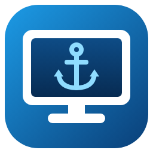

#  Remote Desktop Harbor

A fast, portable Windows app that keeps your Remote Desktop connections and credentials in one encrypted catalog,
opens them in the regular Windows Remote Desktop client with one click, and — with a shared database — shows your team
who is currently connected where.

* **No install, no admin** — one self-contained `RemoteDesktopHarbor.exe` (Windows 10 1809+/11, x64).
* **Two entry kinds** — full *RDP connection* (host + `.rdp` settings + credentials) or *credentials only*.
  Import existing `.rdp` files.
* **Encrypted by the app, bound to you** — AES-256-GCM; the key is protected with DPAPI for your Windows user *and*
  this machine.
* **Local or shared** — local SQLite vault, or a shared SQL Server / Azure SQL database (other SQL engines pluggable)
  with an automatic local offline copy.
* **One-click connect** — launches `mstsc.exe` as a normal window; the password is handed over through Windows
  Credential Manager (never on a command line or in a file) and removed afterwards.
* **Team presence** — "In use by Jane Doe <jane@contoso.com> on PC-42 since 10:31", kept alive by heartbeats with
  an expiry so crashed clients disappear automatically.
* **Sign-in** — Windows account (automatic SSO) or Microsoft Entra ID via the Windows broker.

## Download & run

Grab `RemoteDesktopHarbor-<version>-win-x64.zip` from [Releases](../../releases), unzip anywhere, run
`RemoteDesktopHarbor.exe`. Data is stored in `%LOCALAPPDATA%\RemoteDesktopHarbor`.

* **Portable mode:** create an empty `portable.txt` next to the exe → data goes to `.\data`.
  (Passwords still only decrypt for the same Windows user on the same machine.)
* The `-fdd` zip is a ~10× smaller build for machines that already have the .NET 10 Desktop Runtime.

## Shared database setup (team)

1. Create an empty SQL Server / Azure SQL database. Give the team `db_datareader` + `db_datawriter`; the first start
   needs DDL rights to create the schema (or let a DBA run the app once with "create schema automatically").
2. Create an AD security group for people allowed to read the passwords and note its SID
   (`Get-ADGroup "RDP Vault Users" | Select SID`).
3. In **Settings → Storage**: choose *Shared database*, provider `SqlServer`, connection string, e.g.
   `Server=sql01;Database=Harbor;Integrated Security=true;Encrypt=true`
   or `Server=tcp:x.database.windows.net;Database=Harbor;Authentication=Active Directory Default`,
   and key protection *Active Directory group* with `SID=S-1-5-21-…`. Without AD, choose *Shared passphrase*.
4. Restart. The first client creates the vault key; everyone else picks it up automatically.

Offline: the app starts from its local copy, connections work, edits are disabled until the database is back.

## Entra ID sign-in

Register a public client app in Entra ID with redirect URI `ms-appx-web://microsoft.aad.brokerplugin/<client-id>`
and delegated permission `User.Read`. Enter client id and tenant in **Settings → Sign-in**.

## Build

Requires the .NET 10 SDK. Core libraries and tests build on any OS; the WPF app builds anywhere but runs on Windows.

```bash
dotnet build RemoteDesktopHarbor.slnx
```

```bash
dotnet test RemoteDesktopHarbor.slnx
```

```bash
dotnet publish src/Harbor.App/Harbor.App.csproj -p:PublishProfile=win-x64
```

Output: `artifacts/publish/win-x64/RemoteDesktopHarbor.exe`.

## Repository layout

| Path | Content |
|---|---|
| `docs/spec/SPEC.md` | Requirements (FR/NFR IDs), data & security model — **start here** |
| `docs/adr/` | Architecture decision records |
| `src/Harbor.Core` | Domain, crypto envelope, workspace (sync/offline), presence, `.rdp` handling — OS-neutral |
| `src/Harbor.Data` | ADO.NET/Dapper store + SQL providers (SQLite, SQL Server) |
| `src/Harbor.Windows` | DPAPI / DPAPI-NG, Credential Manager, mstsc launcher, Windows & Entra identity |
| `src/Harbor.App` | WPF UI (MVVM), composition root, settings |
| `tests/` | xUnit tests (run on Linux/macOS/Windows) |

## Contributing

This repo is spec-driven: change `docs/spec/SPEC.md` first, add an ADR for significant decisions, then code + tests.
See [docs/spec/README.md](docs/spec/README.md).
