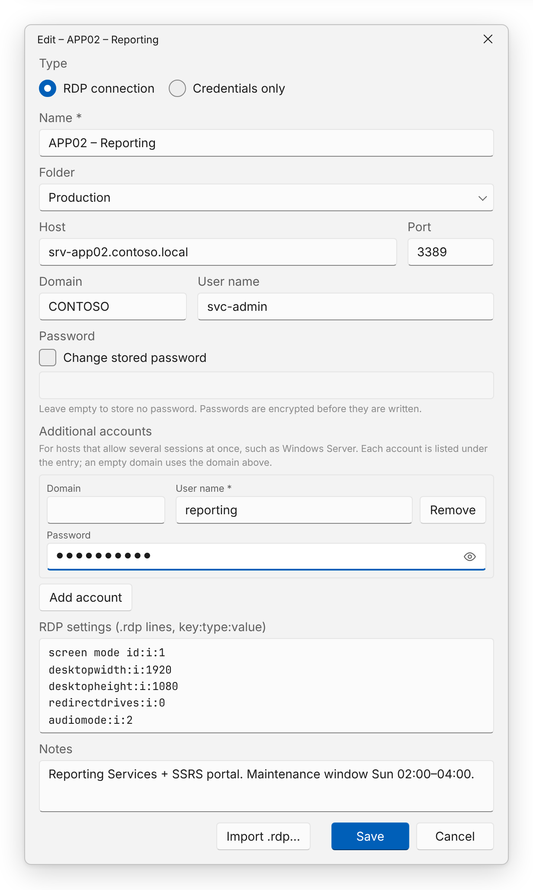

This walk-through uses the default **local vault** — everything stays on your computer. To share entries with a
team, see [Shared database](../../team/shared-database/) afterwards.

## 1. Start the app

Run `RemoteDesktopHarbor.exe`. The main window opens immediately and signs you in with your Windows account in the
background; your name appears in the top-right corner. The status bar shows **Local vault**.

## 2. Create an entry

1. Click **New** (or press <kbd>Ctrl</kbd>+<kbd>N</kbd>).
2. Choose the **Type**:
   - **RDP connection** — a full Remote Desktop profile with optional `.rdp` settings.
   - **Credentials only** — just a user name and password (and optional host); connecting uses default settings.
3. Fill in at least a **Name** and a **Host** (for example `srv-app01.contoso.local`). The **Port** defaults to
   `3389`.
4. Optionally enter **Domain**, **User name** and **Password**, and put the entry in a **Folder** to group it.
5. Click **Save**.

The password is encrypted before it is written to disk.

:::tip
Already have `.rdp` files? Click **Import .rdp…** instead of **New** — see
[Importing .rdp files](../../guides/importing-rdp-files/).
:::

## 3. Connect

Select the entry and click **Connect**, double-click it, or press <kbd>Enter</kbd>. The standard Windows Remote
Desktop client opens in its own window, already signed in with the stored credentials.

## 4. Find things fast

Start typing in the search box (<kbd>Ctrl</kbd>+<kbd>F</kbd>) — the folder tree filters by name, host, user, folder and
notes as you type. Collapse folders you don't need with the arrow next to them.

## Next steps

- [Managing entries](../../guides/managing-entries/) — edit, delete, copy user name and password.
- [Connecting](../../guides/connecting/) — what exactly happens when you click **Connect**.
- [Keyboard shortcuts](../../guides/keyboard-shortcuts/)
