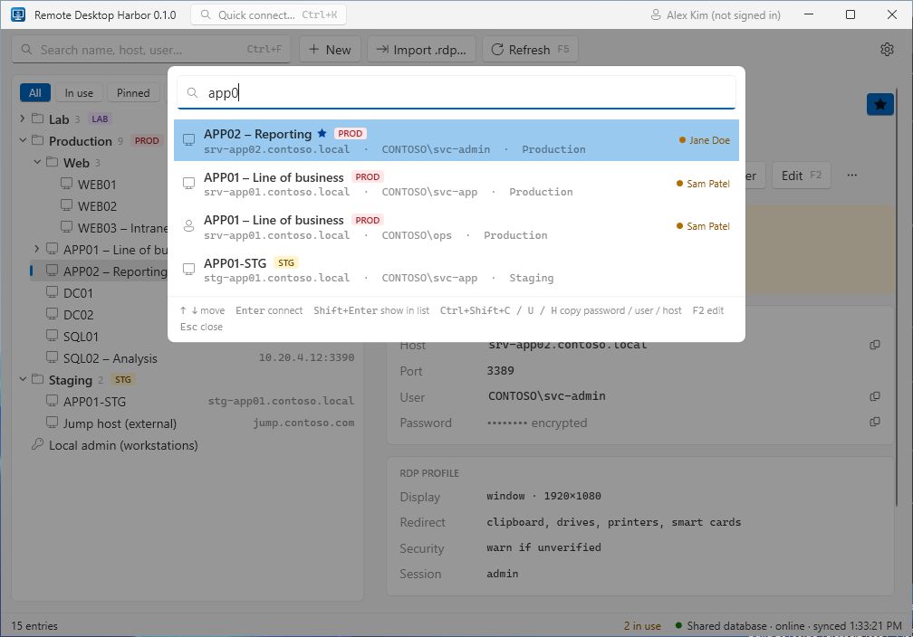

Activate an entry with **Connect as &lt;account&gt;**, a double-click, or <kbd>Enter</kbd> in the list. The button
names the account it connects with. For an entry with
[several accounts](../managing-entries/#several-accounts-per-entry), activate an account row — or pick the account
from the arrow next to the button — to connect as that account; the entry row connects with the default account. The standard Windows Remote
Desktop client (`mstsc.exe`) opens as **its own normal window** — it is not embedded in Harbor, so you can move,
full-screen or close it like any other Remote Desktop session.

## Quick connect

Press <kbd>Ctrl</kbd>+<kbd>K</kbd> (or click **Quick connect…** in the middle of the title bar) and type a few
letters. Every word must match the
name, host, user or folder, so `prod sql` finds the SQL servers in a *Production* folder. Results include each
additional account of an entry, show the environment tag and who is connected, and list pinned and recently used
entries first; with nothing typed, the palette shows your pinned and recent entries.

- <kbd>↑</kbd>/<kbd>↓</kbd> pick a result, <kbd>Enter</kbd> (or a double-click) connects with it.
- <kbd>Shift</kbd>+<kbd>Enter</kbd> only selects it in the list.
- <kbd>Ctrl</kbd>+<kbd>Shift</kbd>+<kbd>C</kbd> / <kbd>U</kbd> / <kbd>H</kbd> copy its password / user name / host,
  <kbd>F2</kbd> edits it — without connecting.
- <kbd>Esc</kbd> or a click outside closes the palette.

## Production entries

Connecting to an entry tagged **PROD** (a folder named *Production*, *Prod*, *PRD* or *Live*, see
[environment tags](../managing-entries/#the-folder-tree)) asks first, naming the entry, its folder and the account,
so a slip of <kbd>Enter</kbd> never opens a production server: in this question (and in the one about taking over
a session, or deleting an entry) **Cancel** is the default, so <kbd>Enter</kbd> and <kbd>Esc</kbd> cancel — click
**Connect** or press <kbd>Tab</kbd> to it. If the connection would also take over someone's session, that question
mentions production instead — you are asked once. Turn it off under
**Settings → Remote Desktop → Ask before connecting to a production (PROD) entry**.

## What happens under the hood

1. **A temporary `.rdp` file is built** in the data folder's `tmp` directory from:
   - the app's defaults (below),
   - the entry's own RDP settings (RDP connections only),
   - the app-managed keys `full address` and `username`.

   Password keys are always stripped — the file never contains a secret.
2. **The password goes to Windows Credential Manager** as a domain credential named `TERMSRV/<host>`, which is where
   `mstsc.exe` looks for saved credentials. It is never passed on a command line (where other processes could read
   it) and never written to the `.rdp` file.
3. **`%SystemRoot%\System32\mstsc.exe <file>.rdp` is started.**
4. **After 30 seconds** the temporary file is deleted and — unless you chose to keep it — the credential is removed
   again. The credential is stored with *session* persistence, so even if Harbor crashes it never survives logoff.
   Leftover `.rdp` files from a crash are swept at the next start.

All accounts of one host share the `TERMSRV/<host>` credential. Connecting as a second account within those
30 seconds is safe: an earlier connection's cleanup never removes the newer credential, and connecting as an account
without a stored password first removes the credential just written for another account, so Remote Desktop
prompts instead of signing you in as the wrong user.

### Default RDP settings

| Setting | Value | Meaning |
|---|---|---|
| `screen mode id` | `2` | Full screen |
| `use multimon` | `0` | Single monitor |
| `prompt for credentials` | `0` | Use the saved credential |
| `authentication level` | `2` | Warn if server authentication fails |
| `redirectclipboard` | `1` | Clipboard redirection on |
| `autoreconnection enabled` | `1` | Reconnect automatically after network drops |

An RDP connection entry can override any of these in its **RDP settings**.

## Keeping the credential

**Settings → Remote Desktop → Keep the password in Windows Credential Manager after connecting**

| | Off (default) | On |
|---|---|---|
| Credential lifetime | Removed ~30 s after launch; never survives logoff | Kept (local-machine persistence) |
| Reconnect from the mstsc window later | May prompt for the password | Works without Harbor |
| Exposure | Minimal | Password stays in your Credential Manager |

With the credential kept, an entry's accounts still share one `TERMSRV/<host>` credential: connecting as an account
that has no stored password may reuse the kept credential of another account. Store a password for every account,
or leave the setting off.

## Connecting to an entry that is in use

With a shared database, an entry another team member is connected to shows a dot and their name in the list. Connecting
with the **same account** asks for confirmation first, because your connection would take over their session.
Connecting with another account of the entry does not ask — Windows Server runs the sessions side by side. See
[Session presence](../../team/session-presence/).

## When Remote Desktop still asks for a password

Some environments block saved credentials for Remote Desktop (Credential Guard, or the *Allow delegating saved
credentials* group policy). Remote Desktop then prompts as usual — use **Copy password**
(<kbd>Ctrl</kbd>+<kbd>Shift</kbd>+<kbd>C</kbd>) and paste.

More in [Troubleshooting](../../reference/troubleshooting/).
