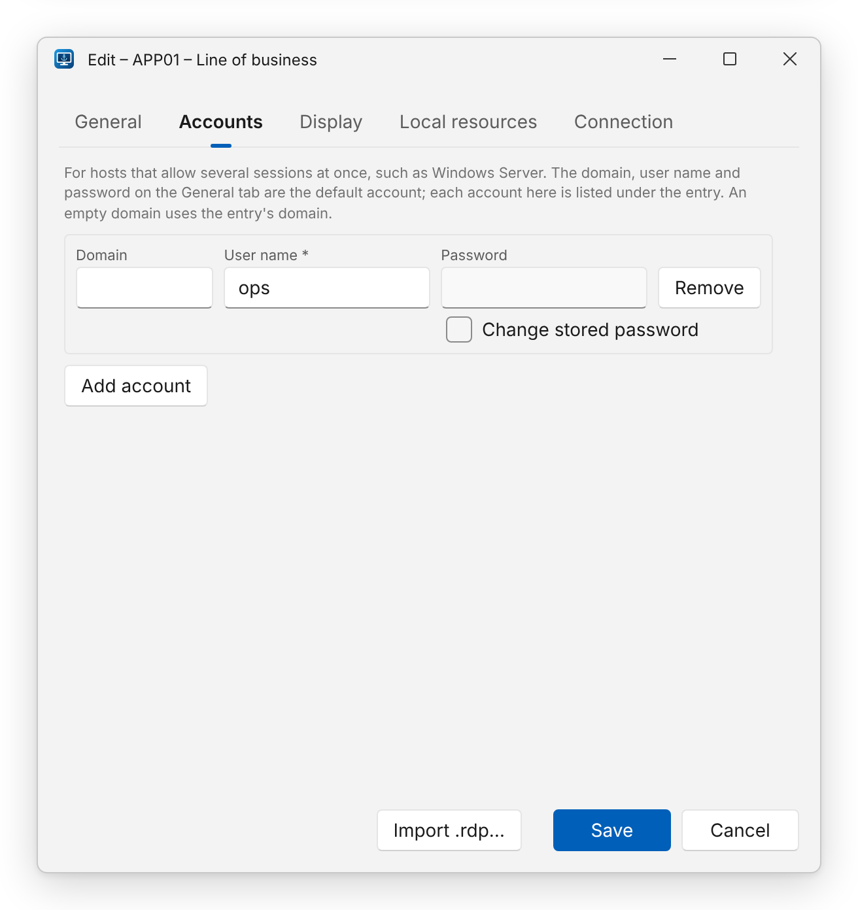
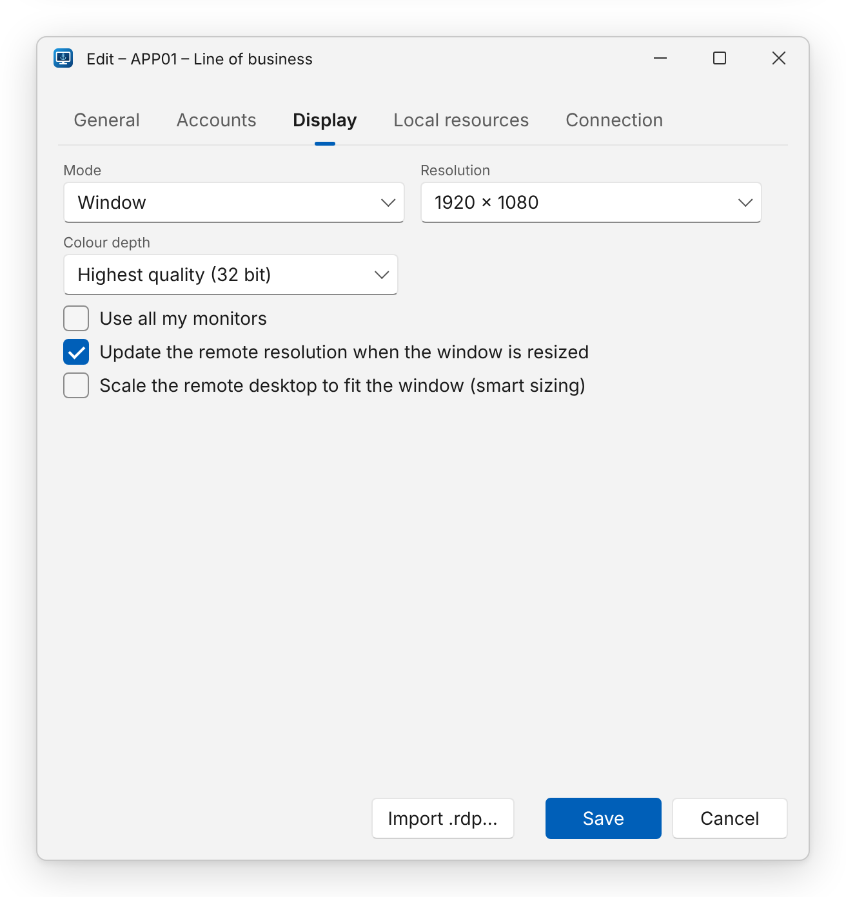

Every item in the catalog is an **entry**. The main window shows the entries on the left in a compact folder tree,
and the details of the selected entry on the right.

## Entry kinds

| Kind | Stores | Connecting uses |
|---|---|---|
| **RDP connection** | Host, port, credentials **and** additional `.rdp` settings | Default settings + the entry's own `.rdp` settings |
| **Credentials only** | User name and password, optional host | Default settings only |

Pick the kind at the top of the editor's **General** tab. You can switch it later; the RDP settings tabs
(**Display**, **Local resources**, **Connection**) are only shown for RDP connections.

## Fields

The editor has five tabs: **General** for the fields below, **Accounts** for
[additional accounts](#several-accounts-per-entry), and **Display**, **Local resources** and **Connection** for the
[RDP settings](#rdp-settings). Errors are shown below the tabs, whichever tab is open.

| Field | Notes |
|---|---|
| **Name** | Required. Shown in the list. |
| **Folder** | Optional. Type a new name or pick an existing one. Use `/` (or `\`) for sub-folders, e.g. `Production/Web`. |
| **Host** / **Port** | Host name or IP address (IPv6 literals like `[fe80::1]` work). Port defaults to `3389`. An entry without a host cannot be launched, but you can still copy its credentials. |
| **Domain** / **User name** | Combined as `DOMAIN\user`. If the user name already contains `\` or `@` (UPN), the domain is not added. |
| **Password** | Optional. Encrypted before it is written to any database. When editing an entry that already has a password, tick **Change stored password** to replace or clear it. |
| **Notes** | Free text. Searchable. |
| **Accounts** tab | Optional. More users for the same host — see [Several accounts per entry](#several-accounts-per-entry). |
| **Display**, **Local resources**, **Connection** tabs | RDP connections only. The common Remote Desktop settings as form fields — see [RDP settings](#rdp-settings). |
| **Other .rdp settings** | RDP connections only, on the **Connection** tab under *advanced*. Any other `.rdp` lines in `key:type:value` format, e.g. `gatewayhostname:s:gw.contoso.com`. |

The details pane also shows who changed the entry last and when.

## Several accounts per entry

Windows Server lets several people — or one person with several accounts — be connected at once. Instead of
copying an entry for each account, add the accounts to one entry:

1. Open the entry in the editor. The **Domain**, **User name** and **Password** on the **General** tab are the
   entry's **default account**.
2. On the **Accounts** tab, click **Add account** and fill in the **User name** (required), an optional
   **Domain** — left empty, the entry's domain is used — and an optional **Password**. Each account takes one row;
   add as many as you need. **Remove** deletes one.
3. Save.

In the tree, an entry with additional accounts gets an arrow: expand it to see one row per account, the default
account first. Select an **account row** and **Connect**, **Copy user** or **Copy password** use that account;
with the **entry row** selected they use the default account. Double-click or <kbd>Enter</kbd> on an account row
connects as that account.

Every account's password is encrypted on its own, exactly like the default one. In a shared database the accounts
are shared and synced with their entry; deleting the entry deletes its accounts too.

## RDP settings

For an RDP connection the editor shows the usual Remote Desktop options as fields on three tabs, like the
*Show options* tabs of the Remote Desktop client:

| Tab | Settings |
|---|---|
| **Display** | **Mode** (full screen or window), **Resolution** (*Match local screen*, common sizes such as 1920 × 1080, or *Custom…* with a width and height of 200–8192 pixels), **Colour depth**, **Use all my monitors**, update the resolution when the window is resized, scale to fit the window (smart sizing) |
| **Local resources** | **Remote audio** (play here, on the remote computer, or not at all), where **Windows key combinations** apply, microphone, **Clipboard**, **Printers**, **Smart cards**, **All local drives** |
| **Connection** | What to do **if server authentication fails**, reconnect automatically, connect to the administrative (console) session, **Other .rdp settings (advanced)** |

New entries start with the defaults (full screen, clipboard on, warn on authentication problems, …); only the
settings you change are stored. Anything else — a Remote Desktop Gateway, specific drives, … — goes into
**Other .rdp settings (advanced)** on the **Connection** tab as ordinary `.rdp` lines; it opens by itself when the entry has such lines.
Settings imported from an `.rdp` file land in the matching fields. See
[RDP settings format](../importing-rdp-files/#rdp-settings-format).

## The folder tree

Each folder and entry is one low row showing just its name; folders also show how many entries they contain, and
entries in use show an **In use by …** badge. Hover an entry for its user and host. Entries with
[several accounts](#several-accounts-per-entry) can be expanded to one row per account.

- Click the arrow next to a folder, double-click it, or press <kbd>←</kbd>/<kbd>→</kbd> to collapse or expand it.
- Right-click the tree for **Expand all** and **Collapse all** (and the actions for the selected entry).
- Folders are matched regardless of case; entries without a folder are listed at the root, after the folders.
- Collapsed folders are remembered the next time you start the app.

## Create

Click **New** (<kbd>Ctrl</kbd>+<kbd>N</kbd>). The new entry starts in the selected folder, or in the folder of the
selected entry.

## Edit

Select an entry and click **Edit**. If saving fails because of a validation or database error, the editor reopens
with your input and the error message.

:::note[Concurrent edits]
In a shared database, if someone else saved the same entry after you opened it, your save is rejected with
**Not saved** rather than silently overwriting their change. The app syncs automatically; open the entry again and
re-apply your edit.
:::

## Delete

Select an entry and click **Delete**, then confirm. In a shared database the entry is removed for everyone.

## Search

Type in the search box (<kbd>Ctrl</kbd>+<kbd>F</kbd>). The tree is filtered as you type, by **name, host, user
(any account), folder and notes**, and every folder with matches is expanded; the status bar shows how many entries match.
<kbd>Esc</kbd> clears the search, <kbd>↓</kbd> moves into the tree. Filtering happens in memory, so it stays
instant with thousands of entries.

## Copy user name and password

Both act on the selected account row, or on the entry's default account when the entry row is selected.

- **Copy user** copies the qualified user name (`DOMAIN\user`).
- **Copy password** (<kbd>Ctrl</kbd>+<kbd>Shift</kbd>+<kbd>C</kbd>) decrypts the password and puts it on the
  clipboard. After **30 seconds** the clipboard is cleared — but only if it still contains that password, so
  anything you copied in between is left alone.

Copying works offline too, and is the fallback when a policy prevents Remote Desktop from using saved credentials.

## Read-only while offline

When the app uses a shared database that is currently unreachable, **New**, **Import .rdp…**, **Edit** and
**Delete** are disabled. See [Offline mode](../../team/offline-mode/).

## Light or dark theme

The three theme icons at the right of the toolbar switch the app between **System** (monitor icon — follows the
Windows light/dark setting, the default), **Light** (sun icon) and **Dark** (moon icon); hover an icon for its name. The change applies immediately and is remembered for the next start.
