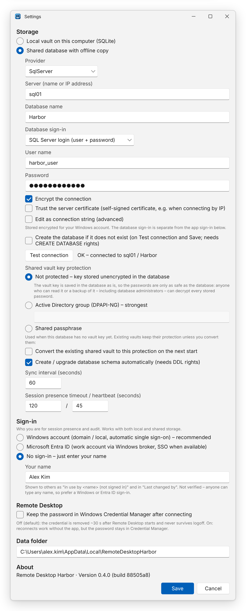

Open **Settings** from the toolbar. After **Save**, the app offers to restart, because storage and sign-in changes
take effect at startup.



Settings are stored as JSON in `settings.json` in the [data folder](../data-and-files/). The remote connection string is
DPAPI-protected for your Windows account, so a copied `settings.json` does not reveal it.

## Storage

| UI | JSON property | Default | Description |
|---|---|---|---|
| Local vault / Shared database | `StorageMode` | `Local` | `Local` — SQLite file on this computer. `Remote` — shared database with offline copy. |
| Provider | `RemoteProvider` | `SqlServer` | Registered database provider for the shared database. |
| Server, Database name, Database sign-in, User name, Password, Encrypt, Trust server certificate | `RemoteConnectionStringProtected` | — | Built into a connection string, DPAPI-protected (base64). Edit it in the UI only. |
| Edit as connection string (advanced) | (same) | off | Edit the raw connection string instead of the fields. Strings the fields cannot describe open here automatically. |
| Create the database if it does not exist | — (not stored) | off | On **Test connection** and **Save**, create the database if missing. Needs `CREATE DATABASE` rights. |
| Shared vault key protection | `RemoteKeyScheme` | `sign-in` | `sign-in` (*Not protected*: key stored unencrypted in the database), `dpapi-ng` (AD group) or `passphrase`. Used when the shared database has no vault key yet. |
| Convert the existing shared vault to this protection | `RemoteKeyConvert` | `false` | One-time: on the next start, re-protect the existing vault key with the chosen protection; cleared afterwards. See [Vault key protection](../../team/vault-key-protection/). |
| (descriptor box) | `RemoteKeyDescriptor` | — | DPAPI-NG protection descriptor, e.g. `SID=S-1-5-21-…`. Required for `dpapi-ng`. |
| Create / upgrade schema automatically | `RemoteAutoMigrate` | `true` | Apply schema migrations at startup. Needs DDL rights. |
| Sync interval (seconds) | `RemoteSyncIntervalSeconds` | `60` | How often the local copy is refreshed. Minimum 10. |
| Session presence timeout | `PresenceTtlSeconds` | `120` | Lifetime of a presence record without heartbeat. |
| Session presence heartbeat | `PresenceHeartbeatSeconds` | `45` | Refresh interval; must be ≤ half the timeout. |

## Sign-in

| UI | JSON property | Default | Description |
|---|---|---|---|
| Windows account / Microsoft Entra ID / No sign-in | `AuthMode` | `Windows` | `Windows` (recommended), `EntraId` or `Anonymous`. Who you are for presence and audit; independent of storage and of the database sign-in. |
| Application (client) ID | `EntraClientId` | — | Required for Entra ID. See [Entra ID sign-in](../../team/entra-id/). |
| Tenant ID or domain | `EntraTenantId` | `organizations` | Tenant ID, domain, or `organizations`. |
| Your name | `AnonymousName` | — | Required for *No sign-in*. Shown to others as “*name* (not signed in)” and in “Last changed by”. Not verified. |

## Remote Desktop

| UI | JSON property | Default | Description |
|---|---|---|---|
| Keep the password in Windows Credential Manager after connecting | `KeepCredentialAfterLaunch` | `false` | Off: credential removed ~30 s after launch and never survives logoff. On: kept, so reconnects work without the app. |

## Data folder

Read-only. Shows where the app stores its data, with “(portable mode)” when [portable mode](../../getting-started/portable-mode/)
is active.

## Remembered by the main window

| UI | JSON property | Default | Description |
|---|---|---|---|
| Folder arrows in the entry tree | `CollapsedFolders` | `[]` | Folders collapsed in the entry tree, restored at start. Written when the app closes. |

## Validation

The dialog refuses to save when:

- shared storage is selected without a server, database name or (for a SQL login) user name — or, when editing the
  raw string, without a connection string,
- the database should be created but that fails (untick the option to save anyway),
- AD-group protection is selected without a descriptor,
- Entra ID is selected without a client ID,
- *No sign-in* is selected without a name,
- the heartbeat is more than half of the presence timeout.

## Example `settings.json`

```json
{
  "StorageMode": "Remote",
  "RemoteProvider": "SqlServer",
  "RemoteConnectionStringProtected": "AQAAANCMnd8BFdERjHoAwE/Cl+sBAAAA…",
  "RemoteKeyScheme": "dpapi-ng",
  "RemoteKeyConvert": false,
  "RemoteKeyDescriptor": "SID=S-1-5-21-1004336348-1177238915-682003330-5126",
  "RemoteAutoMigrate": false,
  "RemoteSyncIntervalSeconds": 60,
  "AuthMode": "Windows",
  "EntraClientId": null,
  "EntraTenantId": "organizations",
  "AnonymousName": null,
  "PresenceTtlSeconds": 120,
  "PresenceHeartbeatSeconds": 45,
  "KeepCredentialAfterLaunch": false,
  "CollapsedFolders": [ "Lab" ]
}
```
