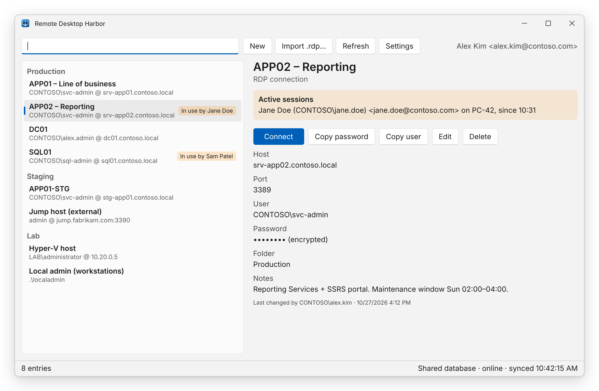
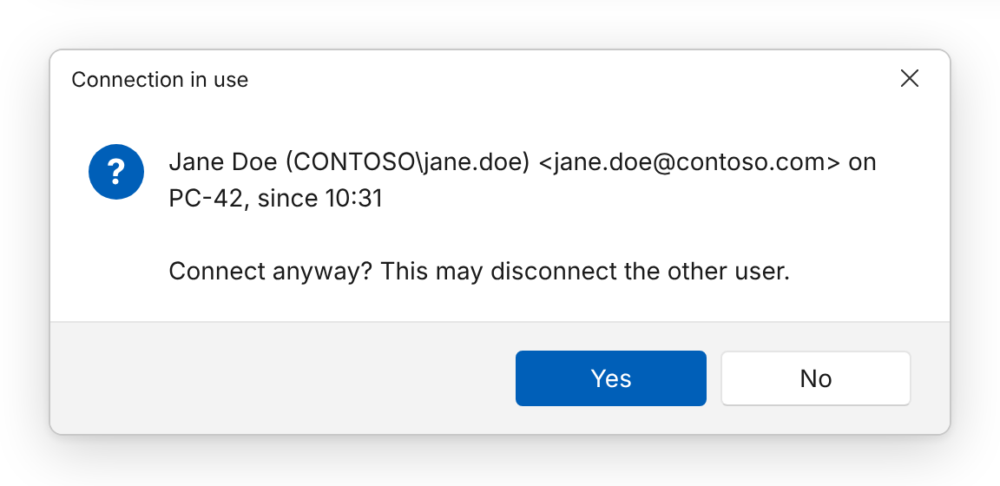

With a shared database, Harbor shows which entries are currently in use and by whom:

> **In use by Jane Doe &lt;jane@contoso.com&gt; on PC-42 since 10:31**

The badge appears in the list; the details pane lists every active session for the selected entry.

## How it works

Presence uses **leases** with an expiry, so crashed or disconnected clients never leave “ghost” sessions behind.

1. When you connect, the app writes a record to `ActiveSessions`: entry, user name, display name, e-mail, machine
   name and start time, **expiring after the TTL** (default 120 s).
2. While the Remote Desktop window is open, the app refreshes the record every **heartbeat** (default 45 s).
3. When the Remote Desktop window closes, the record is deleted.
4. Everyone's app lists only records that have not expired, refreshing the view every 20 s.

All times come from the **database clock**, so a client with a wrong clock cannot make sessions look alive or dead.

| Event | Effect |
|---|---|
| You close the Remote Desktop window (or disconnect) | Record deleted immediately |
| You close Harbor with sessions still open | Harbor asks for confirmation, then ends its records |
| Harbor crashes, laptop sleeps, network drops | Record disappears from everyone's view after at most one TTL |
| Database unreachable when you connect | The session starts anyway; presence is published once the database is back |

Expired records older than a day are purged automatically.

## Connecting to an entry in use

Connecting to an entry that shows **In use** asks for confirmation — on hosts that allow only one session, your
connection may disconnect the other person.

## Settings

**Settings → Storage → Session presence timeout / heartbeat (seconds)**

| Setting | Default | Rule |
|---|---|---|
| Timeout (TTL) | 120 | How long a record lives without a heartbeat |
| Heartbeat | 45 | Must be at most half the timeout |

Lower values make crashed sessions disappear faster at the cost of more database writes.

## Limitations

- Only sessions **started from Harbor** are visible — not ones opened directly with `mstsc.exe`.
- Presence needs the shared database; there is no presence in a local vault.
- While your client is offline it shows no presence at all, rather than stale data.
