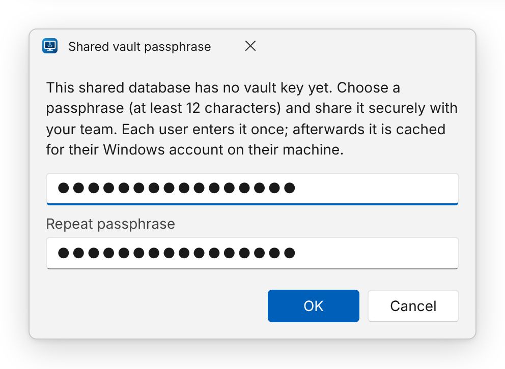

Every vault has one random 256-bit **data-encryption key** (DEK) that encrypts all its passwords
([details](../../reference/security-model/)). In a shared database the DEK must be readable by the team — but not by
a database administrator or anyone holding a backup. The DEK is therefore stored *wrapped* in the `VaultKeys` table.

You choose the wrapping when the shared vault is **created**. Later clients read the scheme stored with the key and
use it automatically, whatever their own settings say.

## Database access only — default, no extra secret

Anyone who can sign in to the shared database opens the vault — with the **Windows account**, a **SQL Server login**
(user name + password entered in Settings) or **Microsoft Entra ID**. Nobody types a passphrase and there is nothing
to set up.

- The app's own sign-in does not matter: Windows, Entra ID and *No sign-in* all work. Your Windows account does not
  need access to the database when you use a SQL login.
- The key is stored in the database without further wrapping. **Anyone who can read the database or a backup of it —
  including database administrators — can read the stored passwords.** Protect the database accordingly, or choose
  one of the options below.

## Active Directory group (DPAPI-NG) — strongest

The DEK is protected with Windows **DPAPI-NG** to a security group, described by its SID:

```text
SID=S-1-5-21-1004336348-1177238915-682003330-5126
```

- Any member of the group can unlock the vault on any domain-joined machine — there is no secret to hand out.
- Membership is managed in Active Directory as usual.
- Requires Active Directory with Windows Server 2012+ domain controllers and a reachable DC the **first** time a
  user unlocks the vault on a machine.

Find the SID with:

```powershell
Get-ADGroup "RDP Vault Users" | Select-Object -ExpandProperty SID
```

## Shared passphrase

For environments without Active Directory. The DEK is encrypted with a key derived from a passphrase
(PBKDF2-SHA256, 600 000 iterations, AES-GCM).

- The creator chooses the passphrase (at least **12 characters**, entered twice).
- Every other user enters it **once per machine** when the app first opens the vault.


- Distribute it through a secure channel (e.g. your password manager), never by e-mail or chat.

## Changing the protection of an existing vault

The choice above is used when a vault is **created**. To change an existing vault (for example from a passphrase to
*Database access only*), pick the new protection in **Settings**, tick
**Convert the existing shared vault to this protection on the next start**, save and restart. The app re-protects
the same key once and then clears the option:

- On a computer that has opened the vault before, no passphrase is needed — the locally cached key is used.
- The key itself does not change, so other users are not asked for anything.

## Cached key on each client

After the first successful unlock, each client stores the DEK in its local cache file, wrapped with DPAPI for
**that Windows user on that machine**. That is why:

- later starts need neither a domain controller nor the passphrase, and
- [offline mode](../offline-mode/) works.

## Removing someone's access

Removing a user from the AD group (or changing the passphrase) stops *future* unlocks, but a client that already
cached the DEK can still decrypt. When someone leaves the team:

1. Change the passwords of the RDP accounts they could see, and update the entries.
2. Key rotation (a new DEK and re-encryption) is planned future work.

:::caution
Anyone who can unlock the vault can read every password in it — that is the purpose of a shared vault.
Per-folder access control is not part of v1.
:::
